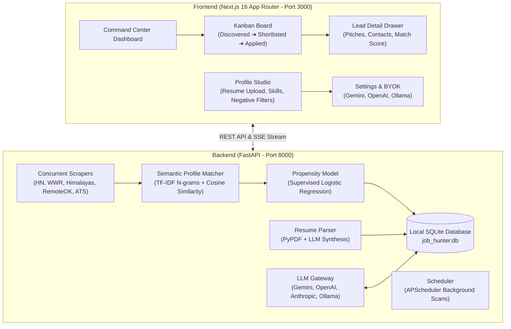

# 🎯 Job Hunter Studio

> **Autonomous Executive Job Hunting, Semantic Profile Matching & Multi-Channel Pitch Engine**

Job Hunter Studio is a production-grade, full-stack platform designed to automate high-signal software engineering and freelance job discovery. It replaces manual job board scrolling with concurrent multi-platform scrapers, dynamic Scikit-Learn TF-IDF profile vectorization, supervised reply propensity modeling, and 1-click multi-channel outreach synthesis.

---

## 🌟 Key Capabilities

- **Strict Data Decoupling & Dynamic Profile Ingestion:** Zero hardcoded personal identities. Drop any PDF or Markdown resume into the **Profile Studio** to automatically extract candidate bio, technical skills, target roles, and negative tech blacklists.
- **Scikit-Learn TF-IDF Semantic Matcher:** Dynamically fits N-gram TF-IDF vectorizers on candidate profile data to compute cosine similarity scores (0–100%) against job titles and descriptions in real time.
- **Supervised Reply Propensity Model:** Logistic Regression classifier predicting conversion likelihood based on technology overlap, role seniority, domain tags (RAG, LLM, Cloud), remote eligibility, and compensation signals.
- **11 Concurrent Scraper Engines:** Scrapes Hacker News ("Who is Hiring" & Freelance threads), WeWorkRemotely, Himalayas, RemoteOK, Remotive, Jobicy, Arbeitnow, and direct ATS career boards (Lever, Ashby, Greenhouse).
- **Multi-Provider BYOK AI Pitch Gateway:** Generate customized cold emails, LinkedIn connection notes (< 280 characters), and 30-second elevator pitches via **Google Gemini**, **OpenAI**, **Groq**, **Anthropic**, or **100% Free Local Ollama** (`$0` token costs).
- **Interactive Kanban Command Center:** 5-stage pipeline (`Discovered` ➔ `Shortlisted` ➔ `Pitch Ready` ➔ `Applied` ➔ `Interviewing`) with slide-out lead drawer, instant copy-to-clipboard, and mailto client launch.
- **Autonomous Background Scheduler:** APScheduler background worker continuously monitors boards at user-defined intervals (6h, 12h, 24h) and stores new opportunities in local SQLite.

---

## 🏛️ Architecture Topology



---

## ⚡ 60-Second Quickstart

### Method 1: 1-Click Native Launcher (Recommended)

Ensure you have Python 3.10+ and Node.js 18+ installed:

```bash
# Clone or navigate to the directory
git clone https://github.com/prat3010/job-hunter.git
cd job-hunter

# Run the 1-click native boot script
./launch.sh
```

`launch.sh` will automatically:
1. Sense Python & create `backend/.venv` if not present.
2. Install Python dependencies with `uv` or `pip`.
3. Install frontend npm packages.
4. Concurrently launch the FastAPI backend on `http://localhost:8000` and Next.js frontend on `http://localhost:3000`.
5. Trap `Ctrl+C` for graceful teardown of both processes.

### Method 2: Containerized Execution with Docker Compose

Run the entire isolated stack in Docker:

```bash
docker compose up -d
```

- **Frontend Command Center:** [http://localhost:3000](http://localhost:3000)
- **Interactive Swagger API Docs:** [http://localhost:8000/docs](http://localhost:8000/docs)

---

## 🛠️ Usage Workflow

### Step 1: Upload or Configure Profile
1. Navigate to **Profile Studio** (`http://localhost:3000/profile`).
2. Drag and drop your PDF resume into the **Resume Dropzone**.
3. Review auto-populated target roles, core technical skills, and candidate summary.
4. Add unwanted technologies to the **Negative Tech Blacklist** (e.g. `wordpress`, `php`, `salesforce`) to guarantee 0-score exclusion.
5. Click **"Save Profile & Re-Index"** to re-train the in-memory TF-IDF semantic matcher.

### Step 2: Configure AI Inference (BYOK)
1. Navigate to **Settings** (`http://localhost:3000/settings`).
2. Choose your preferred AI provider:
   - **Google Gemini** (`gemini-2.5-flash` or `gemini-1.5-flash`)
   - **OpenAI** (`gpt-4o-mini` or `gpt-4o`)
   - **Groq** (`llama-3.3-70b-versatile`)
   - **Anthropic** (`claude-3-5-haiku-20241022`)
   - **Local Ollama** (`http://localhost:11434`, `$0` free local inference)
3. Paste your API key (stored securely in local SQLite, never leaked).
4. Click **"Test AI Connection"** to verify round-trip inference latency.

### Step 3: Run Live Scans & Review Leads
1. Go to **Command Center** (`http://localhost:3000`).
2. Click **"Run Live Scan"** to stream job discovery across active boards.
3. Inspect discovered postings sorted by match score.
4. Filter by **Lead Type** (Full-Time vs Freelance/Contract) or **Propensity Tier** (`A+ High Value`).

### Step 4: Generate Multi-Channel Pitches & Outreach
1. Click any job card to open the **Lead Detail Drawer**.
2. Review the semantic match breakdown and extracted compensation (with INR equivalents).
3. Click **"Generate Pitch"** to produce:
   - **Cold Email:** 3-paragraph tailored pitch with direct hiring manager call-to-action.
   - **LinkedIn Note:** Punchy connection invite strictly under 280 characters.
   - **Elevator Pitch:** 30-second conversational summary.
4. Click **"Copy to Clipboard"** or **"Launch Mail Client"** to dispatch your outreach immediately!

---

## 🧪 Verification & Testing

### Running Backend Unit & Integration Tests

```bash
cd backend
source .venv/bin/activate
pytest -v
```

The test suite validates:
- `test_matcher.py`: TF-IDF cosine similarity scoring, negative keyword exclusions, propensity classification, and compensation extraction regexes.
- `test_resume_parser.py`: PyPDF text parsing and heuristic profile extraction.
- `test_scrapers.py`: Normalization pipeline across direct ATS and RSS feeds.
- `test_api.py`: FastAPI endpoints for profile CRUD, settings, job management, and pitch generation.

### Verifying Frontend Build

```bash
cd frontend
npm run build
```

---

## 📋 REST API Endpoints

| Method | Endpoint | Description |
|---|---|---|
| `GET` | `/health` | Service health status |
| `GET` | `/api/jobs` | Query jobs with status, search, and tier filters |
| `GET` | `/api/jobs/stats` | Aggregate pipeline counts per Kanban status |
| `GET` | `/api/jobs/{id}` | Retrieve specific lead details |
| `PATCH` | `/api/jobs/{id}` | Update lead status or notes |
| `DELETE` | `/api/jobs/{id}` | Dismiss/delete a lead |
| `POST` | `/api/jobs/{id}/pitch` | Generate tailored multi-channel pitches |
| `GET` | `/api/scan/boards` | List available scraping boards |
| `POST` | `/api/scan` | Trigger scan across selected boards |
| `GET` | `/api/scan/stream` | Server-Sent Events (SSE) live progress stream |
| `GET` | `/api/profile` | Get active candidate profile |
| `PUT` | `/api/profile` | Update profile and re-index TF-IDF vectors |
| `POST` | `/api/profile/upload-resume` | Upload PDF resume and extract candidate fields |
| `GET` | `/api/settings` | Get BYOK config and enabled scrapers |
| `PUT` | `/api/settings` | Update AI provider, API keys, and scan schedule |
| `POST` | `/api/settings/test-connection` | Verify inference connectivity and measure latency |

---

## 📄 License

MIT License. Crafted for autonomous engineering excellence.
